# LabLens

**Photograph a physics problem, get a live lab.** LabLens turns a textbook diagram, a whiteboard sketch or a typed problem into an explorable simulation. The simulation runs on physics engines we wrote ourselves, checks its own answer against the textbook formula, and lets students see it, hear it and ask questions about it. It works offline on any device.


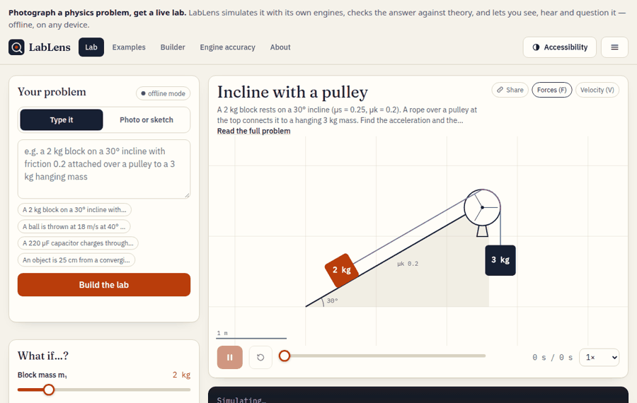

> **Live demo:** _add your deployment URL here_ (see [Deploy](#deploy)). Without an AI key, everything except reading photos and free-form tutor chat works, including typed problems, through the offline parser.

---

## The problem

- **Most young students never get a lab.** In TIMSS 2019, on average across countries, only **36% of fourth-grade students** were in schools with a science laboratory ([TIMSS 2019, IEA](https://timss2019.org/reports/school-resources-for-science-experiments/index.html)).
- **The gap is widest where resources are scarcest.** In South Africa, only **3,926 of 22,597 public schools (17.4%)** have science laboratories, according to the Department of Basic Education's facilities report ([TimesLIVE, Oct 2023](https://www.timeslive.co.za/sunday-times-daily/news/2023-10-02-report-puts-lack-of-school-libraries-and-laboratories-under-microscope/)).
- **Physics participation is slipping.** Preliminary data from the American Institute of Physics shows a **2.7% decrease** in U.S. high-school physics enrollment in 2023 compared with 2018 ([AIP, 2025](https://www.aip.org/aip/preliminary-data-shows-decline-in-high-school-physics-course-enrollment)).
- **Physics is taught through pictures, and many students can't see them.** At least **2.2 billion people** have a vision impairment ([WHO World report on vision](https://www.who.int/publications/i/item/world-report-on-vision)). Free-body diagrams, graphs and ray diagrams are mostly inaccessible to blind students.

Textbook physics is static. A student can compute that *a = 3.24 m/s²* without ever watching the block accelerate, asking *"what if the hanging mass doubles?"*, or building intuition. Existing simulators come with fixed menus of pre-built scenes, so none of them can simulate **the problem on the student's own worksheet**.

## What LabLens does

| Step | What happens | Works offline? |
|---|---|---|
| **1. Perceive** | Photo or text becomes a typed **Scene Graph**. A **free** vision model (Google Gemini's free tier by default, or a local Ollama model) returns strict JSON, Zod validation and semantic checks run on it, and an **automatic repair loop** fixes failures. A rule-based offline parser handles typed problems with no AI. A *"Did I understand this correctly?"* card shows what was read, what was assumed and the confidence, and the student can edit it. | Text: ✅ · Photo: needs AI |
| **2. Simulate** | Three engines **written from scratch**: constrained rigid-body mechanics (RK4 / Verlet / symplectic Euler, Lagrange-multiplier constraints, friction, ropes over pulleys, springs, collisions, drag); circuits by **Modified Nodal Analysis** (trapezoidal companion models, complex AC sweep); a **2D ray tracer** (Snell, total internal reflection, Fresnel, mirrors, thin and thick lenses). They run in a Web Worker. | ✅ |
| **3. Verify** | An independent analytic layer recognises the textbook setup, derives the **closed-form answer**, and shows *simulated vs. analytic* with % error. Every scene also passes **universal audits**: energy conservation, Kirchhoff, Tellegen and Snell residuals. | ✅ |
| **4. Explore** | Sliders for every parameter, play/pause/scrub, live plots, force and velocity arrows, an **auto-generated free-body diagram**, and an event timeline. **Pin a run** and its graphs stay as dashed lines while you move a slider, so before and after sit on one plot. **Download any graph as CSV** for a lab report. **Share a lab as a link**: the scene, with your slider values, is compressed into the URL, so nothing is uploaded. | ✅ |
| **5. Learn Socratically** | **Predict → Test → Explain**: the student commits to a prediction, the engine runs the experiment, and the prediction is **graded by the simulation itself**. With AI enabled, the tutor sees the live lab state and proposes experiments as buttons. | Experiments: ✅ · Chat: needs AI |
| **6. Accessible from day one** | **Sonification** of any graph (pitch = value, pan = time, clicks at zero crossings), screen-reader narration of events, full keyboard control (press **?** for the shortcut sheet), data tables behind every graph, OpenDyslexic font, larger text, dark/light themes, reduced motion. Installable PWA. | ✅ |

### The 20-second "wait, it did that?"
With the AI service enabled, hold up the sketch below and press **Build the lab** (offline, type the problem instead). In about three seconds the block is sliding up the incline with force arrows, a velocity graph is drawing itself, and the instrument strip reads **✔ Simulated a = 3.244 m/s² · Analytic = 3.244 m/s² · error 2e-6%**. Drag the hanging-mass slider and everything updates. Press **Listen** and you hear the velocity graph.

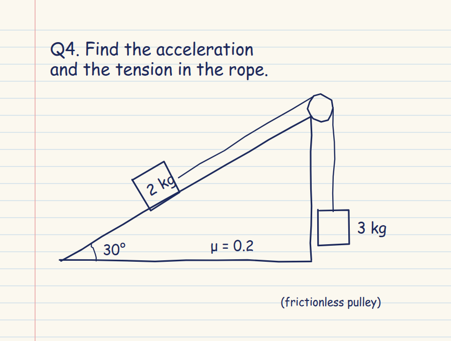

## Screenshots
| | |
|---|---|
| 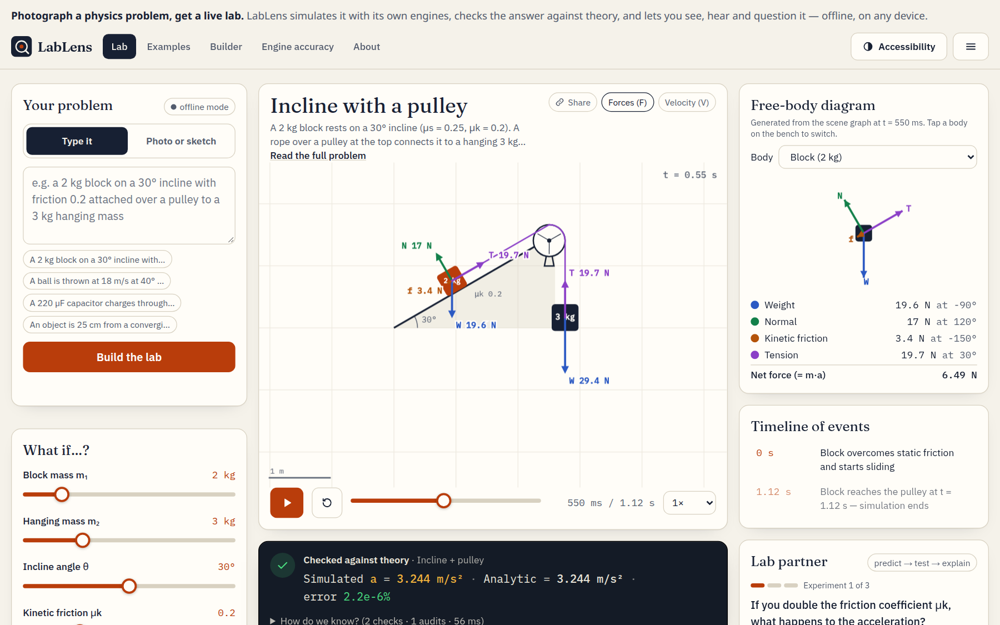 **The lab:** live forces, free-body diagram, verification | 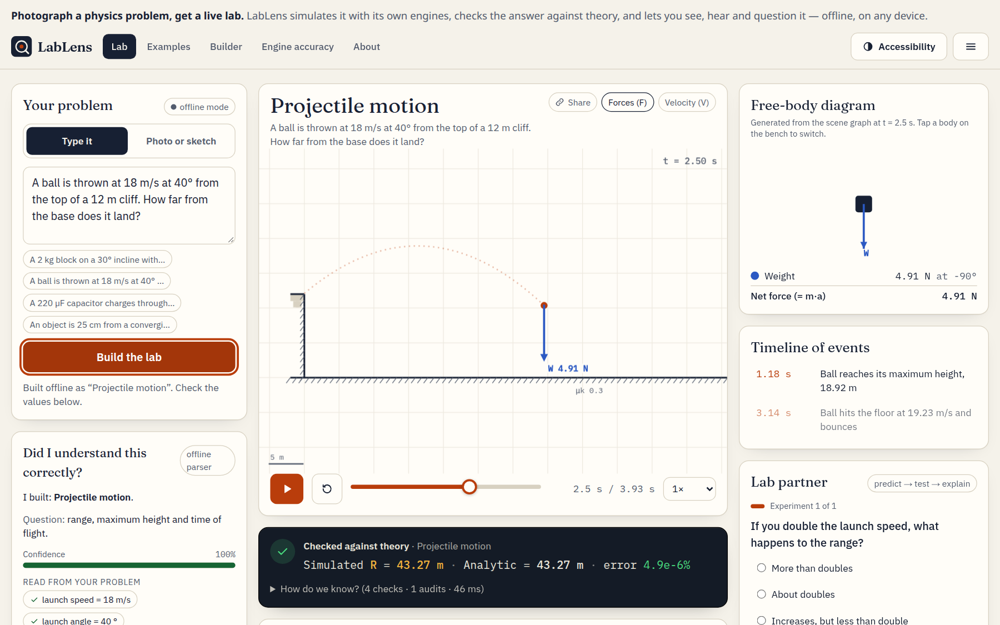 **Typed problem → offline parse →** *"Did I understand this?"* |
| 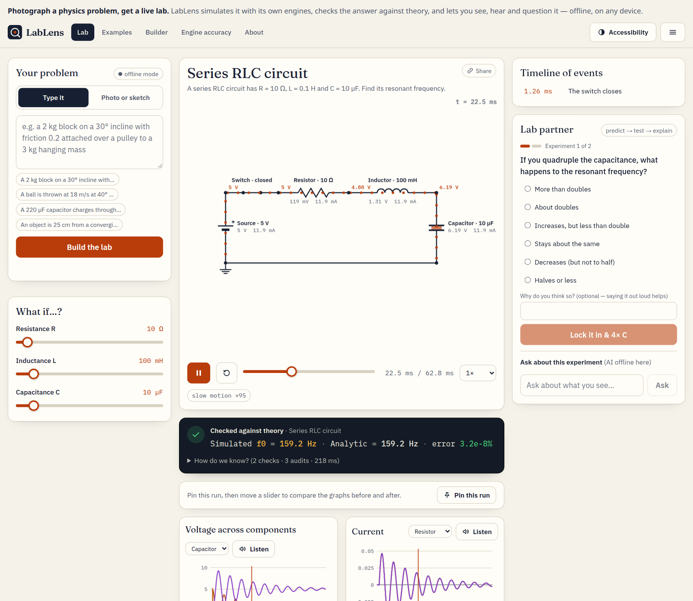 **RLC circuit:** current flow, ringing, resonance | 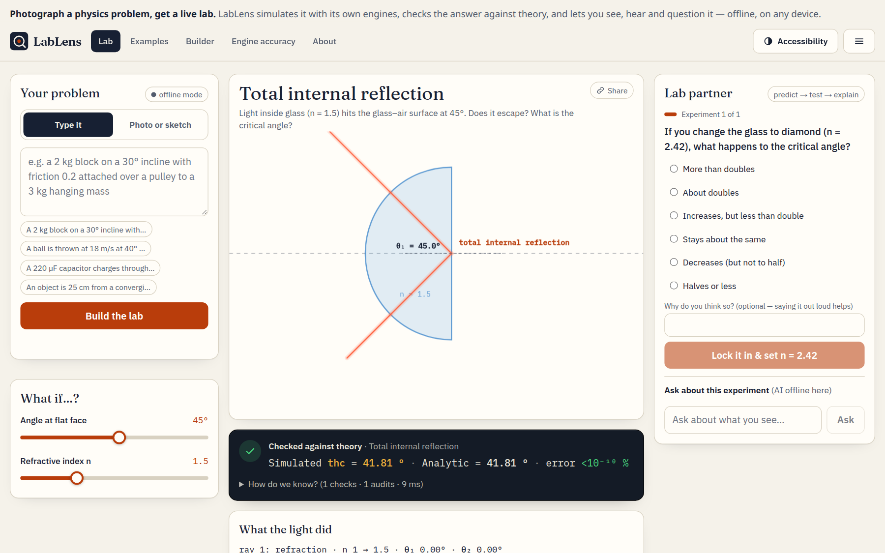 **Total internal reflection**, critical angle found by bisection |
| 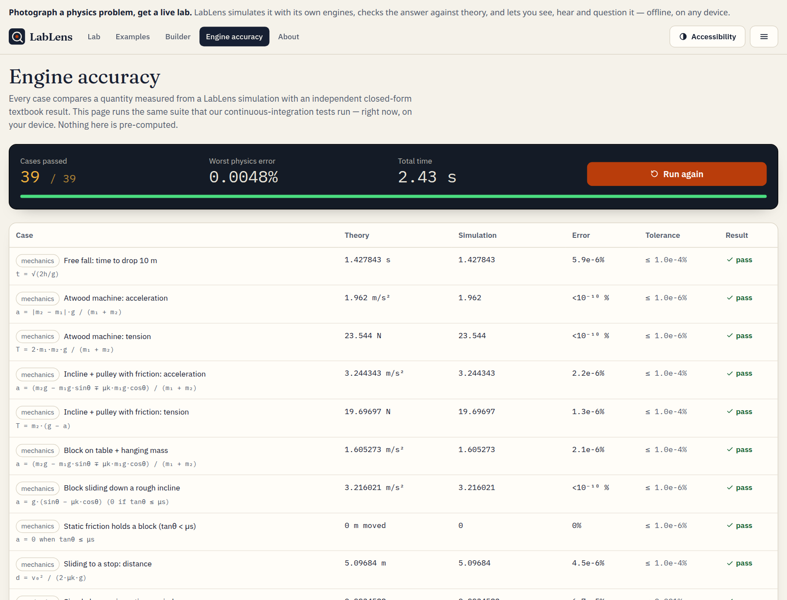 **Engine Accuracy page** runs the test suite live | 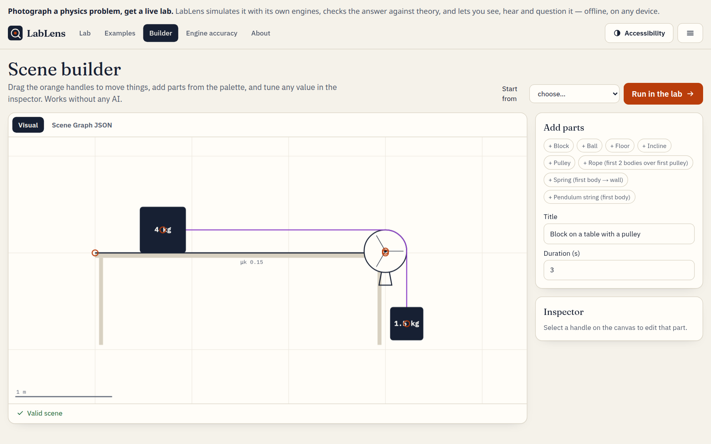 **Drag-and-drop builder** with live validation |
| 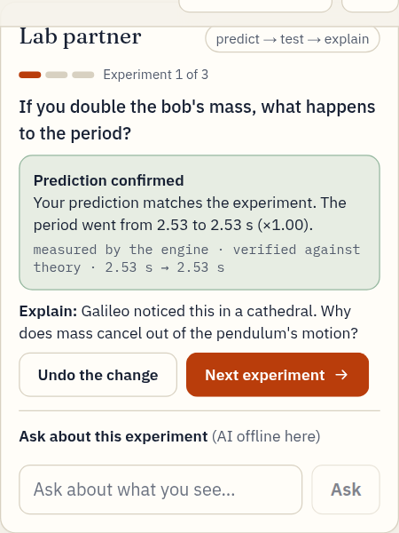 **Predict → test → explain**, graded by the engine | 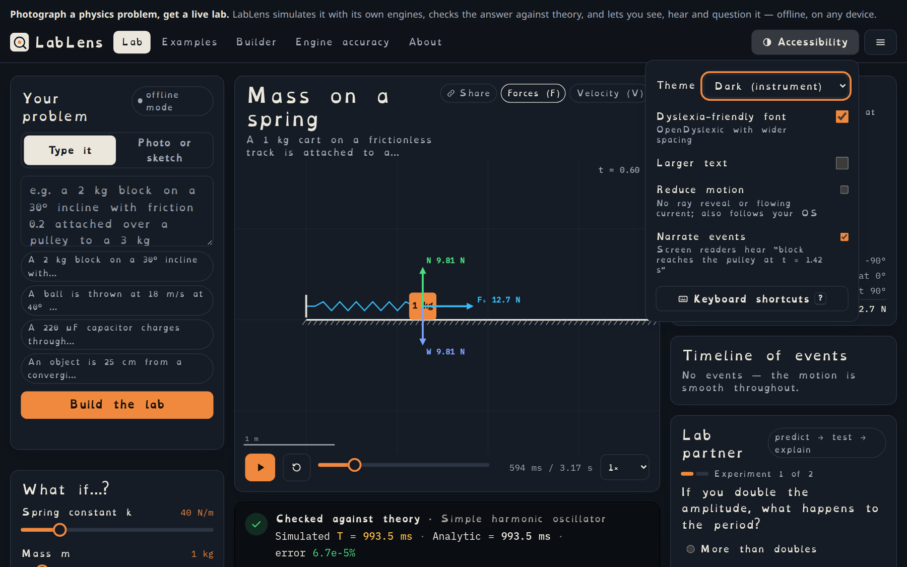 **Dark theme + OpenDyslexic + keyboard map** |

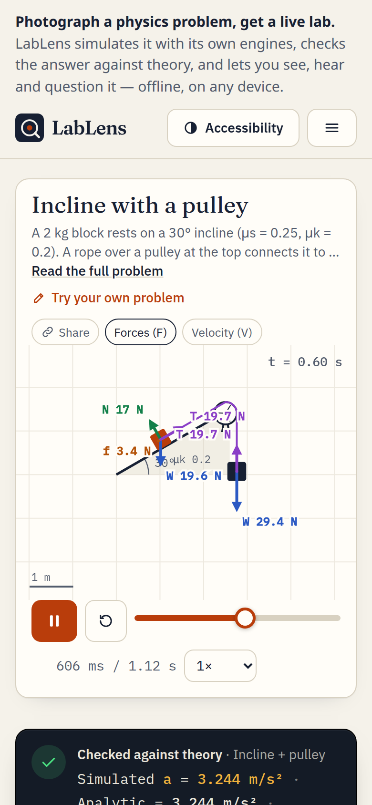 &nbsp; 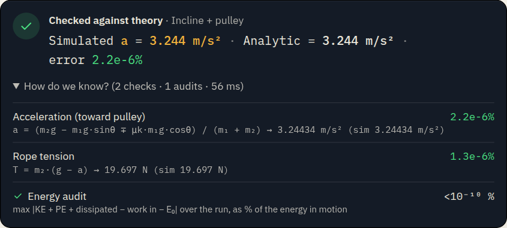

## Architecture

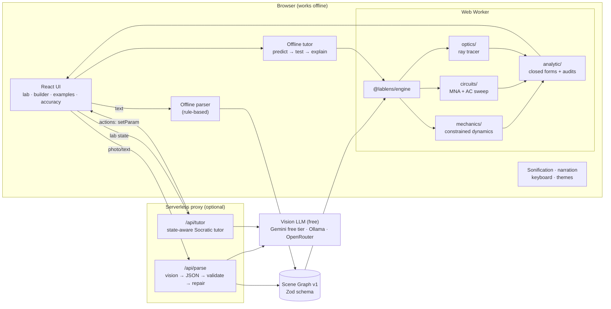

```
lablens/
├─ packages/engine/        framework-free TypeScript (only dependency: zod)
│  └─ src/ schema/ mechanics/ circuits/ optics/ analytic/ math/
│          templates/ parse/ tutor/ validation/ describe.ts run.ts
├─ apps/web/               Vite + React 19 + Tailwind 4 + PWA
├─ api/                    serverless functions: health, parse, tutor (any free LLM)
├─ docs/                   screenshots, audits (axe, Lighthouse), accuracy table
└─ scripts/                audit.mjs (axe), screenshots.mjs
```

## The Scene Graph

Every part of LabLens speaks one versioned, Zod-validated format (`packages/engine/src/schema/scene.ts`), documented in [`packages/engine/src/schema/README.md`](packages/engine/src/schema/README.md):

```jsonc
{
  "version": "1", "id": "incline-pulley", "title": "Incline with a pulley", "domain": "mechanics",
  "mechanics": {
    "bodies":   [{ "id": "m1", "mass": 2, "position": {"x":0.6,"y":0.5}, "onSurface": "ramp" },
                 { "id": "m2", "mass": 3, "position": {"x":2.9,"y":0.9} }],
    "surfaces": [{ "id": "ramp", "kind": "incline", "from": {"x":0,"y":0}, "to": {"x":2.6,"y":1.5}, "muStatic": 0.25, "muKinetic": 0.2 }],
    "pulleys":  [{ "id": "P", "position": {"x":2.5,"y":1.6}, "radius": 0.22 }],
    "ropes":    [{ "id": "rope", "bodyA": "m1", "bodyB": "m2", "via": [{"pulley":"P","side":"top"},{"pulley":"P","side":"right"}] }]
  },
  "params": [{ "id": "m2", "label": "Hanging mass m₂", "path": "template.args.m2", "min": 0.5, "max": 10, "step": 0.1, "unit": "kg" }],
  "template": { "name": "inclinePulley", "args": { "m1": 2, "m2": 3, "angle": 30, "muS": 0.25, "muK": 0.2 } }
}
```

The parsers produce it, the builder edits it, the engines simulate it, the tutor reads it, and `params[].path` is how sliders and the tutor's `setParam` actions change it. Validation has two stages, **structural** (Zod) and **semantic** (every rope, spring and component references real bodies and nodes, ground exists, params point at numbers). The AI repair loop feeds back exactly these issue messages.

## Engine accuracy

These numbers are generated by running the code (`npm run bench`). The same suite gates CI in Vitest and runs live in the browser on the **Engine accuracy** page.

| Case | Analytic | Simulated | Error | Tolerance | Result |
|---|---|---|---|---|---|
| Free fall: time to drop 10 m | 1.427843 s | 1.427843 | 5.9e-6% | 1.0e-4% | ✅ |
| Atwood machine: acceleration | 1.962000 m/s² | 1.962000 | <10⁻¹⁰ % | 1.0e-6% | ✅ |
| Atwood machine: tension | 23.54400 N | 23.54400 | <10⁻¹⁰ % | 1.0e-6% | ✅ |
| Incline + pulley with friction: acceleration | 3.244343 m/s² | 3.244343 | 2.2e-6% | 1.0e-4% | ✅ |
| Incline + pulley with friction: tension | 19.69697 N | 19.69697 | 1.3e-6% | 1.0e-4% | ✅ |
| Block on table + hanging mass | 1.605273 m/s² | 1.605273 | 2.1e-6% | 1.0e-4% | ✅ |
| Block sliding down a rough incline | 3.216021 m/s² | 3.216021 | <10⁻¹⁰ % | 1.0e-6% | ✅ |
| Static friction holds a block (tanθ < μs) | 0.000000 m moved | 0.000000 | 0% | 1.0e-6% | ✅ |
| Sliding to a stop: distance | 5.096840 m | 5.096840 | 4.5e-6% | 1.0e-4% | ✅ |
| Simple harmonic motion: period | 0.9934588 s | 0.9934582 | 6.7e-5% | 0.001% | ✅ |
| Damped oscillator: damped period | 1.150219 s | 1.150218 | 2.6e-5% | 0.001% | ✅ |
| Pendulum at 40°: exact period | 2.533921 s | 2.533921 | 4.5e-6% | 0.001% | ✅ |
| Pendulum at 80°: exact period (elliptic integral) | 2.281886 s | 2.281882 | 1.8e-4% | 0.001% | ✅ |
| Pendulum: string tension at the bottom | 14.40020 N | 14.40020 | 6.7e-6% | 0.001% | ✅ |
| Projectile: horizontal range | 20.86311 m | 20.86312 | 1.1e-5% | 0.001% | ✅ |
| Projectile: maximum height | 7.462259 m | 7.462259 | <10⁻¹⁰ % | 1.0e-6% | ✅ |
| Terminal velocity with quadratic drag | 15.66046 m/s | 15.66026 | 0.0013% | 0.01% | ✅ |
| Elastic collision: final velocity | -0.6666667 m/s | -0.6666667 | <10⁻¹⁰ % | 1.0e-9% | ✅ |
| Energy conservation: pendulum over 20 s | 0.000000 J | 0.000002058289 | 3.5e-5% | 1.0e-4% | ✅ |
| RK4 convergence order | 4.000000 order | 3.999899 | 0.0025% | 5% | ✅ |
| Velocity Verlet convergence order | 2.000000 order | 2.000008 | 4.0e-4% | 5% | ✅ |
| Semi-implicit Euler convergence order | 1.000000 order | 1.001627 | 0.16% | 10% | ✅ |
| RC charging: time constant τ = RC | 1.000000 s | 1.000005 | 5.0e-4% | 0.01% | ✅ |
| RC charging: initial current V/R | 0.005000000 A | 0.005000000 | 0% | 1.0e-6% | ✅ |
| RC discharging: time constant | 1.000000 s | 1.000005 | 5.0e-4% | 0.01% | ✅ |
| RL circuit: time constant τ = L/R | 0.02000000 s | 0.02000081 | 0.0041% | 0.01% | ✅ |
| Series RLC: resonant frequency | 159.1549 Hz | 159.1549 | 3.2e-8% | 1.0e-5% | ✅ |
| Series RLC: damped ringing period | 0.006291054 s | 0.006291061 | 1.1e-4% | 0.01% | ✅ |
| Voltage divider | 3.000000 V | 3.000000 | <10⁻¹⁰ % | 1.0e-9% | ✅ |
| Parallel resistors: equivalent resistance | 54.54545 Ω | 54.54545 | 0% | 1.0e-9% | ✅ |
| Wheatstone bridge: galvanometer current | 0.0007233273 A | 0.0007233273 | <10⁻¹⁰ % | 1.0e-9% | ✅ |
| Snell's law: angle of refraction | 25.37399 ° | 25.37399 | 0% | 1.0e-9% | ✅ |
| Glass slab: lateral displacement | 0.3353628 m | 0.3353628 | <10⁻¹⁰ % | 1.0e-9% | ✅ |
| Critical angle for total internal reflection | 41.81031 ° | 41.81031 | <10⁻¹⁰ % | 1.0e-6% | ✅ |
| Thin lens equation: image distance | 1.000000 m | 1.000000 | <10⁻¹⁰ % | 1.0e-9% | ✅ |
| Thin lens: magnification | -0.6666667 × | -0.6666667 | <10⁻¹⁰ % | 1.0e-9% | ✅ |
| Thin lens: virtual image | -1.333333 m | -1.333333 | <10⁻¹⁰ % | 1.0e-9% | ✅ |
| Concave mirror: focal length R/2 | 1.200000 m | 1.200000 | 8.6e-8% | 1.0e-4% | ✅ |
| Thick lens: lensmaker back focal distance | 0.9655172 m | 0.9654708 | 0.0048% | 0.05% | ✅ |

**39/39 pass.** Measured convergence orders are 4.000 for RK4, 2.000 for velocity Verlet and 1.002 for semi-implicit Euler, matching theory.

## Accessibility

| Feature | How |
|---|---|
| Hear any graph | Web Audio sonification: pitch ∝ value (220–880 Hz, log), stereo pan = time, click at each zero crossing, low/high reference tones first. Key **L**. |
| Narration | `aria-live` announces events as the playhead passes them (*"Block reaches the pulley at t = 1.12 s"*). **D** describes the current moment and **S** describes the whole scene. Both are generated deterministically from the Scene Graph. |
| Keyboard | Space play/pause · ←/→ step (Shift ×10) · Home/End · F forces · V velocity. All controls are native and focusable, with a visible focus ring. |
| Not just visual | Every graph has a data table, every canvas has a text description, and the free-body diagram is also a list of forces with magnitudes and directions. |
| Reading & vision | OpenDyslexic toggle, larger text, light (paper) and dark (instrument) themes. Every colour pair meets WCAG AA. |
| Motion | Honours `prefers-reduced-motion`, plus an in-app toggle. |
| Low bandwidth | Installable PWA. After the first visit the engines, examples and fonts work offline. Photos are resized on the device before upload. |

**Audits (on the built app):** axe-core 4.14 reports **0 violations on 7 pages × 2 themes** (WCAG 2.2 A/AA + best practices), stored in [`docs/audits/axe.json`](docs/audits/axe.json). Lighthouse 12.8 on the lab page scored **desktop 100 / 100 / 100 / 100** and **mobile 93 / 100 / 100 / 100** (performance / accessibility / best practices / SEO) in the stored report. Repeated mobile runs on the same build scored 93–97. Reports are in [`docs/audits/`](docs/audits/).

## Quick start (≤ 3 commands)

```bash
git clone https://github.com/OWNER/lablens.git && cd lablens
npm ci
npm run dev        # http://localhost:5173 (offline mode works with no key)
```

### Free AI (optional)
Photo parsing and AI chat use **free** models. No paid API is needed. Copy `.env.example` to `.env` and set **one** of these:

| Provider | Cost | Setup | Notes |
|---|---|---|---|
| **Google Gemini free tier** (default) | Free, rate-limited | Free key at [aistudio.google.com/apikey](https://aistudio.google.com/apikey) → `GEMINI_API_KEY=` | Default model `gemini-3.5-flash-lite` accepts images. Free-tier prompts may be used by Google to improve its products, so don't send personal data. |
| **Ollama** (local) | Free, unlimited | Install [ollama.com](https://ollama.com), `ollama pull qwen2.5vl:7b` → `OLLAMA_BASE_URL=http://localhost:11434` | Runs on a school server or laptop. Fully private and works with **no internet**. Gets a compact prompt suited to small models. |
| **OpenRouter** `:free` models | Free, about 50 requests/day | `OPENROUTER_API_KEY=` + `LLM_MODEL=<vision model id ending in :free>` | Good backup. |
| **Groq** free tier | Free, rate-limited | `GROQ_API_KEY=` | Fast. The default model is text-only (typed problems and chat). |
| Claude | Paid | `ANTHROPIC_API_KEY=` | Optional; strongest vision. |

Keys are read only on the server side; the dev server mounts the same `/api` handlers that Vercel deploys. With no key at all, LabLens stays in offline mode.

## Testing

```bash
npm test           # 129 tests: engine (101), web UI and share links (10), AI proxy + LLM layer with the network mocked (18)
npm run bench      # prints the engine accuracy table above
npm run lint && npm run typecheck && npm run format:check
node scripts/audit.mjs   # axe audit (needs `npm run build && npm run preview`)
```

CI (GitHub Actions) runs lint, format, typecheck, all tests, the accuracy table (posted to the job summary) and the production build on every push.

## Deploy

- **Vercel (full features):** import the repo. `vercel.json` sets the build and output and deploys `api/*.ts` as functions. Add a free `GEMINI_API_KEY` (or any provider above) in the project's environment variables.
- **GitHub Pages (offline features only):** enable Pages with "GitHub Actions" as the source. `.github/workflows/pages.yml` builds with the right base path.

## Tech stack
TypeScript (strict) · React 19 · Vite 8 · Tailwind CSS 4 · Canvas 2D · Web Audio · Web Workers · Zod 4 · vite-plugin-pwa (Workbox) · Vitest · Testing Library · ESLint · Prettier · axe-core · Lighthouse · OpenAI-compatible LLM protocol (free Gemini tier / Ollama / OpenRouter / Groq; Claude optional) · Vercel Functions.

## Roadmap and honest limits
- **Done:** all three engines, verification and audits, 25 examples, builder, offline parser, offline and AI tutor, AI perception with a repair loop, sonification and narration, share links, pinned-run comparison, CSV export, PWA, CI, audits.
- **Not yet:** rigid-body *rotation* (balls slide, they don't roll), massive pulleys, nonlinear circuit elements (diodes, transistors), wave optics and dispersion, multi-language UI, classroom/teacher dashboards.
- **Not yet validated:** we have **not** run studies with students yet, so we make no claims about learning gains. That is the next milestone, together with screen-reader user testing by blind students.
- **AI parsing** is unit-tested through its validation and repair code paths with the model mocked out. It has also been spot-checked live on the free `gemini-3.5-flash-lite` tier (26 Nov 2026): the bundled sample sketch, a typed incline problem and an out-of-scope problem (vertical circle, correctly refused) all parsed correctly on the first attempt in 1–5 s. That is a handful of cases, not a benchmark. Accuracy on real messy photos needs a labelled test set, which is on the roadmap.

## Credits & license
Third-party libraries and their licenses are in [CREDITS.md](CREDITS.md). AI-assisted development is disclosed in [AI_DISCLOSURE.md](AI_DISCLOSURE.md), and [HOW_IT_WORKS.md](HOW_IT_WORKS.md) explains every core module. The code is MIT licensed (see [LICENSE](LICENSE)).
